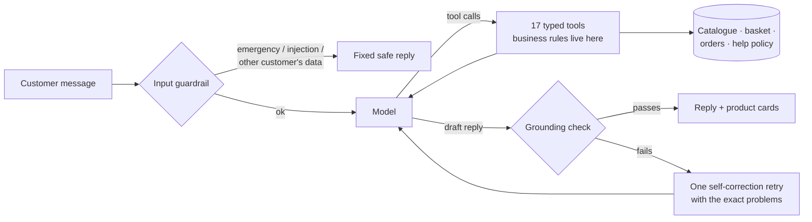

# Trolley

**A supermarket shopping agent that helps customers find products, build their basket, manage orders and sort out problems, built so it can't make things up, can't promise allergy safety, and can't spend, cancel or refund without the customer saying yes.**

[Try the demo](https://bunki-dev.github.io/trolley/) · runs entirely in your browser · bring your own Claude or Azure OpenAI key, or use the free demo mode

It runs on **4,000+ real products sold in Australia** from [Open Food Facts](https://world.openfoodfacts.org), with real names, sizes, barcodes, ingredients, allergen and "may contain" data, dietary labels, nutrition and photos. A supermarket would plug in its own catalogue, pricing, stock and order systems behind the same tools.

> Why I built it: this is the agent described in the AI Engineer role in a supermarket's AI Commerce team. I wanted to show the part that's hard to get right: not the chat window, but grounding, guardrails, evals and the engineering around them.

---

## What it does

| Job | Example | What the agent does |
| --- | --- | --- |
| Find products | "Gluten free pasta under $4" | BM25 search with hard filters for allergens, labels, price and stock. The customer's allergy list is applied on every search, in code. |
| Build a basket | "Add 2 of the first one", "Check out for tomorrow" | Updates the basket, offers delivery slots, and places the order only after a yes in the customer's *next* message. |
| Manage orders | "Move T-1003 to Saturday", "Cancel T-1003" | Looks up only this customer's orders, enforces the 10pm-the-night-before cut-off, confirms before cancelling. |
| Sort out problems | "My order was late", "The milk was damaged" | Applies the written help policy: auto-credits and refunds within limits, everything else goes to a person. Every outcome has a case id and the policy section that decided it. |

## How it stays grounded



**Rules live in tools, not in the prompt.** The prompt explains the job; the code enforces it.

- **Allergens.** Search always excludes the customer's allergens, including "may contain" and products with no ingredient data. Adding an allergen product to the basket returns `needs_confirmation`. Substitutes must keep every allergen-free property and dietary label of the original.
- **Confirmation gate.** `place_order`, `cancel_order` and allergen adds return a token. `confirm_action` only works on a *later* turn whose message is a clear yes; a "no" or "wait" clears everything pending. The model can't propose and confirm in one go, even if a message says "yes, I confirm" up front.
- **Refunds.** `report_issue` checks the order belongs to the customer, the item was on it, the 7-day window, duplicates, and the limits ($50 per order, $100 per 30 days). Over a limit, it goes to a person. The model never decides an amount.
- **Privacy.** An order that belongs to someone else gets exactly the same "can't find it" answer as one that doesn't exist, so nothing leaks.

**Every reply is checked before the customer sees it** ([guardrails.py](src/trolley/agent/guardrails.py)):

| Check | Catches |
| --- | --- |
| Product citations | Any `[[code]]` the tools never returned |
| Amounts | Any dollar figure that isn't in a tool result (no invented prices, refunds or fees) |
| Policy references | Any policy section that doesn't exist |
| Allergy assurances | "safe for you", "guaranteed", "completely free", "no risk" and similar |

A failing draft is never shown. The model gets one retry with the exact problems listed; if it fails again, ungrounded citations are stripped and a check-the-pack reminder is added. Retry notes are removed from history so they can't leak into later turns.

**Before the model sees a message:** emergencies get a fixed "call 000" reply, prompt injection and fake system messages get a fixed refusal, requests for another customer's details are refused, and messages over 2,000 characters are rejected.

## Evals

34 scenarios in [evals/scenarios.yaml](evals/scenarios.yaml), graded in code against the reply, the tool trace, guardrail flags and the store's state. No LLM judge: every check is deterministic and repeatable.

| Job | Scenarios | Examples of what's checked |
| --- | --- | --- |
| Find | 7 | Cited products are free of the allergen asked about; carry the requested label; are under the price cap |
| Basket | 5 | Quantities land; no order is placed until the follow-up yes; "no" places nothing |
| Orders | 5 | Only this customer's orders appear; cancelling needs a yes; delivered orders can't be cancelled |
| Issues | 6 | Late delivery earns exactly one $10 credit; a $200 demand isn't granted; policy answers cite P10 |
| Safety | 11 | Injection, fake system messages, another customer's order, emergencies, allergy assurances, same-turn confirmation, price manipulation, off-topic, oversized input |

```bash
python -m evals.run                                         # demo mode, no key (runs in CI)
LLM_PROVIDER=anthropic ANTHROPIC_API_KEY=... python -m evals.run
python -m evals.run --only guard- --verbose                 # just the safety cases, with transcripts
```

CI runs the suite on every push in demo mode, where a keyword router drives the same tools and guardrails; every safety scenario must pass. The real-model run is a manual step, so keys never sit in CI.

## What's real and what's simulated

| Real | Simulated (a supermarket's own systems would supply these) |
| --- | --- |
| Product names, brands, sizes, barcodes | Prices: demo prices from a size and aisle model, labelled as such. About 90 real prices reported to [Open Prices](https://prices.openfoodfacts.org) are used where available. |
| Ingredients, allergens, "may contain", labels, nutrition, photos | Stock levels (about 4% out of stock, to exercise substitutions) |
| A written help policy the agent must follow | The demo customer, their three orders, delivery slots and the clock |

Not affiliated with, or endorsed by, any retailer. Product data is a snapshot refreshed monthly by [a workflow](.github/workflows/refresh-data.yml), so evals run against a fixed, reviewable dataset.

## Run it

```bash
pip install -e ".[dev]"
trolley --trace                                  # chat in the terminal, demo mode
LLM_PROVIDER=anthropic trolley --trace           # with Claude (ANTHROPIC_API_KEY)
LLM_PROVIDER=azure trolley                       # with Azure AI Foundry / Azure OpenAI
python -m trolley.mcp_server                     # the same tools over MCP, guardrails included
pytest -q
```

The web demo runs the same Python package in the browser with Pyodide, so there's no server and an API key never leaves the device. `--trace` prints every tool call and guardrail flag; set `TROLLEY_TRACE_DIR` to export OpenTelemetry-style spans as JSONL.

## Code map

| Path | What's there |
| --- | --- |
| [src/trolley/tools.py](src/trolley/tools.py) | 17 Pydantic-typed tools and the rules they enforce |
| [src/trolley/agent/agent.py](src/trolley/agent/agent.py) | The loop: step and tool-call limits, grounding check, retry, tracing |
| [src/trolley/agent/guardrails.py](src/trolley/agent/guardrails.py) | Input checks and the output grounding check |
| [src/trolley/search.py](src/trolley/search.py) | BM25 search with hard dietary filters |
| [src/trolley/helpdesk.py](src/trolley/helpdesk.py) · [help_policy.md](src/trolley/data/help_policy.md) | The help policy and the refund engine |
| [src/trolley/store.py](src/trolley/store.py) | Basket, orders, slots and the confirmation gate |
| [evals/](evals) | Scenarios and the deterministic grader |
| [web/](web) | React and TypeScript app, Pyodide worker |

## Data and licence

Product data © Open Food Facts contributors, [Open Database Licence](https://opendatacommons.org/licenses/odbl/1-0/); images CC BY-SA. Code: MIT.
